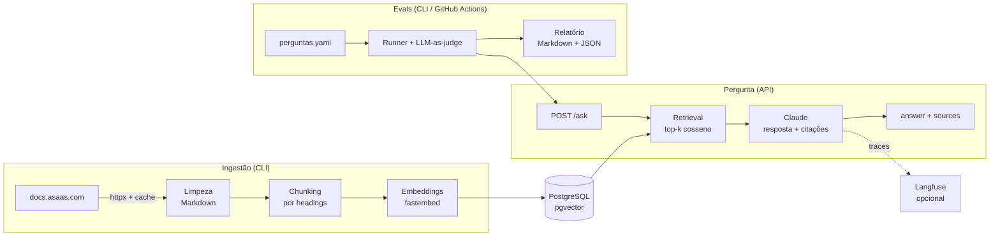

# assistente-docs-rag

> Assistente que responde dúvidas sobre a documentação da API do Asaas, com RAG, respostas com fonte e evals automáticas.

[](https://github.com/Linykercs/assistente-docs-rag/actions/workflows/ci.yml)

[](LICENSE)

Você pergunta em português ("Como crio uma cobrança via Pix?") e recebe uma resposta baseada
**apenas** na [documentação pública do Asaas](https://docs.asaas.com), com o link de cada página
usada. Quando a documentação não cobre o assunto, o assistente diz que não sabe; quando a
pergunta é ambígua, ele pede mais contexto em vez de chutar.

O projeto cobre o ciclo completo de um app de IA em produção:

**extração → chunking → embeddings → banco vetorial → respostas com fonte → evals → deploy**

Recorte atual da documentação: **Autenticação, Cobranças (Pix e boleto) e Webhooks**.

## Arquitetura



## Como funciona

1. **Extração.** A lista de páginas fica em [`sources.yaml`](sources.yaml). A documentação do
   Asaas publica um índice para LLMs (`llms.txt`) e uma versão Markdown de cada página
   (`<url>.md`), então o fetcher prefere o Markdown e só converte HTML como fallback. As
   requisições são identificadas por um `User-Agent` próprio, espaçadas por um intervalo e
   cacheadas em `data/raw/`.
2. **Limpeza.** Frontmatter, componentes JSX (`<Callout>`, `<Anchor>`), diagramas e seções
   geradas (definição OpenAPI, links de navegação) são removidos; texto, tabelas e blocos de
   código ficam intactos.
3. **Chunking.** Cada página é dividida pelos títulos (`#`, `##`, `###`), e cada chunk guarda a
   URL, o título da página e a trilha de headings. Seções longas são quebradas em parágrafos,
   com sobreposição entre chunks vizinhos.
4. **Embeddings e armazenamento.** Os chunks são vetorizados localmente
   (`intfloat/multilingual-e5-large`) e gravados no pgvector. A ingestão é idempotente: o hash
   do conteúdo evita reprocessar o que não mudou, e chunks que saíram da documentação são
   removidos.
5. **Resposta.** A pergunta é vetorizada, os `k` chunks mais próximos (similaridade de
   cosseno) viram o contexto, e o Claude responde só com base neles, citando `[n]` a cada
   afirmação. A saída é estruturada (`status`, `answer`, `cited_ids`), então a API devolve
   apenas fontes que realmente estavam no contexto — o modelo não consegue inventar um link.
6. **Evals.** Um conjunto de perguntas com gabarito mede se o assistente recupera a página
   certa, cita fontes, recusa o que não sabe e responde corretamente.

## Stack

| Camada | Tecnologia |
| --- | --- |
| API | Python 3.12, FastAPI, Pydantic v2 |
| LLM | Claude (Anthropic), via SDK oficial, com saída estruturada |
| Embeddings | fastembed (ONNX, local), modelo multilíngue E5 |
| Banco vetorial | PostgreSQL + pgvector (índice HNSW, distância de cosseno) |
| Ingestão | httpx, BeautifulSoup, markdownify |
| Observabilidade | Langfuse (opcional) |
| Qualidade | pytest, ruff, GitHub Actions |
| Deploy | Docker, Google Cloud Run |

## Como rodar

Pré-requisitos: [Docker](https://docs.docker.com/get-docker/), [uv](https://docs.astral.sh/uv/)
e uma chave de API da Anthropic.

```bash
# 1. Configuração
cp .env.example .env            # preencha ANTHROPIC_API_KEY

# 2. Dependências e banco
uv sync
docker compose up -d db
uv run assistente-docs init-db

# 3. Ingestão da documentação (a primeira execução baixa o modelo de embeddings)
uv run assistente-docs ingest

# 4. Pergunte pelo terminal...
uv run assistente-docs ask "Como crio uma cobrança via Pix?"

# ...ou suba a API em http://localhost:8000 (docs interativas em /docs)
uv run uvicorn assistente_docs.api.app:app --reload

# 5. Evals e testes
uv run assistente-docs eval
uv run pytest
uv run ruff check .
```

Para rodar tudo em containers: `docker compose up --build` sobe o banco e a API, e os comandos
de CLI rodam com `docker compose run --rm api assistente-docs <comando>`.

## API

### `POST /ask`

```bash
curl -X POST http://localhost:8000/ask \
  -H "Content-Type: application/json" \
  -d '{"question": "Como me autentico na API?"}'
```

Formato da resposta (conteúdo ilustrativo):

```json
{
  "status": "answered",
  "answer": "Envie a sua chave de API no header `access_token` de cada requisição [1]. ...",
  "sources": [
    {
      "id": 1,
      "url": "https://docs.asaas.com/docs/autenticação-1",
      "title": "Autenticação",
      "section": "Configure os headers",
      "score": 0.87
    }
  ],
  "model": "claude-sonnet-5-5"
}
```

| Campo | Descrição |
| --- | --- |
| `status` | `answered` (respondeu), `no_answer` (a documentação consultada não cobre o assunto) ou `needs_clarification` (a pergunta é ambígua e o assistente pede contexto) |
| `answer` | Texto em português, com marcadores `[n]` apontando para `sources` |
| `sources` | Trechos citados: página, seção, URL e similaridade com a pergunta |

### `GET /health`

Retorna `{"status": "ok"}`.

## Evals

As perguntas ficam em [`evals/perguntas.yaml`](evals/perguntas.yaml). Cada caso tem a pergunta,
a resposta esperada, a página onde a resposta está e se a documentação responde ou não.

| Métrica | O que mede | Quando se aplica |
| --- | --- | --- |
| **Comportamento** | O assistente fez o que devia: respondeu, recusou (`tem_resposta: false`) ou pediu contexto (categoria `ambigua`) | Sempre |
| **Citação** | Toda resposta dada cita ao menos uma fonte recuperada | Quando o assistente responde |
| **Retrieval hit** | A página esperada (`fonte`) está entre os chunks recuperados | Quando `fonte` está preenchida |
| **Corretude** | Um LLM juiz compara a resposta com a `resposta_esperada` escrita por uma pessoa | Quando `resposta_esperada` está preenchida |

Casos sem gabarito ainda contam para comportamento e citação; as demais métricas ficam como
`n/a` e não entram na taxa. O relatório sai em Markdown e JSON em `evals/reports/`.

O workflow [Evals](.github/workflows/evals.yml) roda a suíte completa no GitHub Actions sob
demanda (`workflow_dispatch`): sobe um Postgres com pgvector, ingere a documentação, executa as
perguntas e publica o relatório como artifact. Ele usa o secret `ANTHROPIC_API_KEY` do
repositório.

## Observabilidade

Com `LANGFUSE_PUBLIC_KEY` e `LANGFUSE_SECRET_KEY` definidas (e o extra instalado:
`uv sync --extra observability`), cada pergunta gera um trace no Langfuse com o retrieval
(páginas e scores) e a geração (modelo, resposta e tokens). Sem as chaves, o tracing fica
desligado e nada muda no restante da aplicação.

## Deploy no Cloud Run

A imagem já inclui o modelo de embeddings, então o container sobe sem downloads.

```bash
gcloud run deploy assistente-docs-rag \
  --source . \
  --region southamerica-east1 \
  --memory 4Gi --cpu 2 \
  --set-env-vars LLM_MODEL=claude-sonnet-5-5 \
  --set-secrets ANTHROPIC_API_KEY=anthropic-api-key:latest,DATABASE_URL=database-url:latest
```

- **Banco:** qualquer PostgreSQL com a extensão `vector` (Cloud SQL, Neon, Supabase). A
  `DATABASE_URL` fica no Secret Manager.
- **Schema e ingestão:** rode `assistente-docs init-db` e `assistente-docs ingest` apontando
  para o banco de produção (da sua máquina ou em um Cloud Run Job com a mesma imagem).
- **Memória:** o modelo E5 large pede cerca de 4 GiB. Um modelo multilíngue menor
  (`EMBEDDING_MODEL` + `EMBEDDING_DIM`) reduz custo e cold start, ao preço de qualidade no
  retrieval.

## Estrutura do projeto

```text
.
├── src/assistente_docs/
│   ├── api/                # FastAPI: rotas e schemas
│   ├── ingestion/          # fetcher, limpeza, chunking e pipeline de ingestão
│   ├── rag/                # retrieval, prompt, integração com o Claude e serviço RAG
│   ├── evals/              # dataset, juiz, métricas, runner e relatório
│   ├── db/schema.sql       # schema do pgvector
│   ├── bootstrap.py        # montagem dos componentes a partir das settings
│   ├── cli.py              # init-db, ingest, ask, eval
│   ├── config.py           # settings (variáveis de ambiente)
│   ├── embeddings.py       # embeddings locais (fastembed)
│   ├── models.py           # tipos de domínio
│   ├── observability.py    # tracing opcional com Langfuse
│   └── store.py            # armazenamento e busca no pgvector
├── tests/                  # testes unitários (sem rede, banco ou chaves)
├── evals/perguntas.yaml    # conjunto de avaliação
├── sources.yaml            # páginas da documentação indexadas
├── .github/workflows/      # CI (lint + testes) e evals sob demanda
├── Dockerfile
└── docker-compose.yml
```

## Decisões e trade-offs

- **Embeddings locais.** Rodar o modelo com fastembed elimina uma segunda chave de API e o
  custo por token, e deixa a ingestão reproduzível em qualquer máquina e no CI. O preço é uma
  imagem maior e mais memória. O modelo é multilíngue porque a documentação e as perguntas
  estão em português.
- **pgvector em vez de um banco vetorial dedicado.** Para algumas centenas de chunks, o
  Postgres resolve com folga e mantém vetores e metadados em um só lugar, com SQL,
  transações e upsert idempotente. Menos uma peça de infraestrutura para operar.
- **Grounding e citações.** Em documentação de pagamentos, uma resposta inventada custa caro.
  Por isso o modelo só pode usar os trechos recuperados, cada afirmação aponta para um trecho,
  e "não sei" é uma resposta válida — medida nas evals tanto quanto as respostas certas.
- **Saída estruturada.** O `status` e os ids citados vêm em campos próprios, validados por
  schema. Isso torna o comportamento verificável por código (API e evals) sem interpretar
  texto livre.
- **Markdown da própria documentação.** Usar as páginas `.md` evita depender do HTML do site
  e deixa a limpeza simples e testável. A definição OpenAPI embutida nas páginas de
  referência é descartada por enquanto: é JSON bruto, que piora o retrieval.
- **Busca só vetorial.** Simples de entender e de medir. Busca híbrida entra no roadmap se as
  evals mostrarem falhas com termos exatos (nomes de eventos, campos).

## Status

Em construção — semana 1 de 12. A base do código já existe: ingestão, banco vetorial, API,
evals, testes e CI. Os próximos passos são preencher o gabarito das evals, medir a primeira
linha de base e publicar o deploy.

## Roadmap

- [x] Definição do recorte e das perguntas de avaliação
- [x] Ingestão da documentação (fetch, limpeza, chunking)
- [x] Embeddings locais e armazenamento no pgvector
- [x] Respostas com fonte, recusa e pedido de esclarecimento
- [x] API (`POST /ask`, `GET /health`) e CLI
- [x] Runner de evals com relatório em Markdown e JSON
- [x] Testes unitários, CI e workflow de evals
- [ ] Gabarito das evals preenchido e primeira linha de base
- [ ] Deploy público no Cloud Run
- [ ] Parâmetros da referência da API (OpenAPI) indexados de forma estruturada
- [ ] Busca híbrida (vetorial + full-text do Postgres)
- [ ] Evals automáticas a cada mudança de prompt ou de chunking

## Licença

[MIT](LICENSE)
